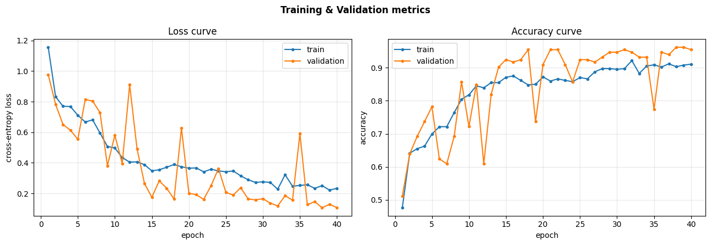
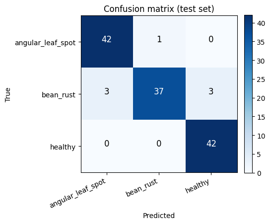
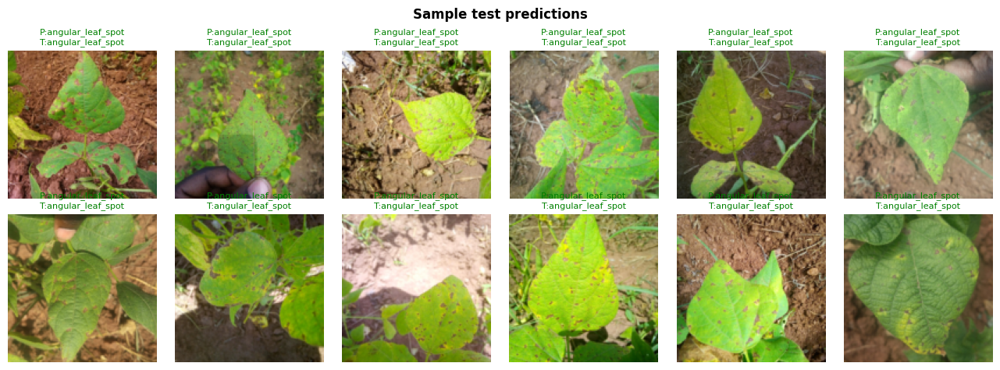

# CNN Development on a Custom Dataset — Bean Leaf Disease Classification

CVPR (Computer Vision & Pattern Recognition) — Mid Assignment

- **Student Name:** Zarin Tasnim Prionty
- **Student ID:** 23-50078-1

A custom Convolutional Neural Network (CNN), trained **from scratch** (no pre-trained
weights), that classifies images of bean plant leaves into three classes:
`angular_leaf_spot`, `bean_rust`, and `healthy`.

## Dataset

**Beans** (Makerere AI Lab) — open-access, hosted on Hugging Face
(`AI-Lab-Makerere/beans`). It is loaded as a standard **ImageFolder** dataset.

| Split | Images | angular_leaf_spot | bean_rust | healthy |
|-------|:------:|:-----------------:|:---------:|:-------:|
| train | 1035 | 345 | 348 | 342 |
| validation | 133 | 44 | 45 | 44 |
| test | 128 | 43 | 43 | 42 |

The notebook **downloads and extracts the dataset automatically** on first run, so no
manual setup is needed. (The `data/` folder is git-ignored.)

## Model

`BeanCNN` — a compact VGG-style network:

- 4 convolutional blocks (`Conv→BN→ReLU→Conv→BN→ReLU→MaxPool`), widths `32→64→128→256`
- `AdaptiveAvgPool2d(4)` + a dropout-regularised classifier head → 3 logits
- Trained with **Adam** + **CrossEntropyLoss**, `ReduceLROnPlateau` scheduler, and the
  best-validation checkpoint is kept.

## Repository contents

| File | Description |
|------|-------------|
| `CNN_23-50078-1.ipynb` | Full implementation with code, outputs and visualisations |
| `models/CNN_23-50078-1.pth` | Saved trained model checkpoint |
| `results/` | Exported figures (training curves, confusion matrix, predictions) |
| `requirements.txt` | Python dependencies |

## How to run

```bash
pip install -r requirements.txt
jupyter notebook CNN_23-50078-1.ipynb   # run all cells top-to-bottom
```

Runs on CPU or GPU (it auto-detects CUDA, e.g. on Kaggle/Colab).

**Running on Kaggle (recommended, free GPU):** see [`KAGGLE.md`](KAGGLE.md) for a
step-by-step guide (enable GPU + Internet, then *Run All*).

## Results

Trained from scratch for 40 epochs on a Kaggle **GPU (Tesla T4)**.

**Test accuracy: 94.53% (121 / 128)**

| Class | Precision | Recall | F1-score | Support |
|-------|:---------:|:------:|:--------:|:-------:|
| angular_leaf_spot | 0.933 | 0.977 | 0.955 | 43 |
| bean_rust | 0.974 | 0.860 | 0.914 | 43 |
| healthy | 0.933 | 1.000 | 0.966 | 42 |
| **accuracy** | | | **0.945** | **128** |

### Training & validation curves


### Confusion matrix (test set)


### Sample test predictions


The main confusion is between `angular_leaf_spot` and `bean_rust` (both are
brown/necrotic lesions), while `healthy` leaves are classified almost perfectly.
